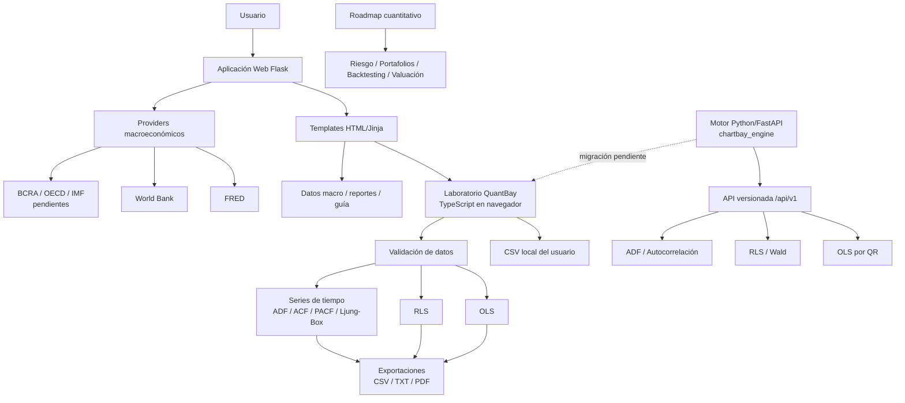

# Informe técnico de arquitectura de ChartBay

Fecha de auditoría: 2026-06-30  
Repositorio auditado: `C:\Users\santi\Claude\Projects\indicador tv ia`

## 1. Resumen Ejecutivo

ChartBay es una plataforma web orientada al análisis econométrico, financiero y cuantitativo. El proyecto combina una interfaz web accesible con motores de cálculo propios y una arquitectura preparada para evolucionar desde un laboratorio educativo hacia una plataforma técnica más robusta.

El sistema tiene tres líneas principales:

1. **Aplicación web principal**: una aplicación Flask que sirve la experiencia web, organiza las pantallas del producto, expone APIs auxiliares y conecta módulos de datos, reportes y navegación.
2. **Laboratorio econométrico QuantBay**: un módulo TypeScript que corre en el navegador y permite cargar CSV, validar datos, estimar modelos OLS/RLS, analizar series de tiempo y exportar resultados.
3. **Motor Python/FastAPI `chartbay_engine`**: un backend cuantitativo en evolución, separado por capas, diseñado para cálculos econométricos más estables y futura expansión hacia finanzas cuantitativas.

El foco técnico actual está en econometría aplicada, análisis de datos y construcción de una base escalable. El área de finanzas existe como dirección estratégica y roadmap, pero todavía no debe presentarse como un motor financiero completo. El proyecto tiene componentes secundarios y exploratorios, pero no son el centro de la arquitectura ni de la propuesta técnica.

## 2. Alcance de la Auditoría

Se revisaron las partes relevantes del repositorio para entender la arquitectura real del sistema:

- Aplicación Flask: `web/app.py`, `web/db.py`, templates, estáticos y endpoints.
- Laboratorio QuantBay: `quantbay/src/`, tests, build Vite y bundle compilado.
- Motor FastAPI: `backend/chartbay_engine/`, schemas, servicios, core econométrico y tests.
- Providers macroeconómicos: paquete `providers/`.
- Pipeline auxiliar de análisis técnico: `data.py`, `indicators.py`, `analyze.py`, `main.py`.
- Configuración de despliegue: `Procfile`, `render.yaml`, `requirements.txt`.
- Documentación existente: `README.md`, `backend/README.md`, `docs/VALIDATION.md`.

El informe no intenta vender capacidades que no existen. Donde una funcionalidad está incompleta, se indica explícitamente.

## 3. Arquitectura General

ChartBay funciona hoy como una aplicación Flask que sirve una interfaz web multipágina. Dentro de esa interfaz, el laboratorio econométrico QuantBay se ejecuta en el navegador como un bundle JavaScript compilado desde TypeScript. En paralelo, el repositorio contiene un backend Python/FastAPI que implementa cálculos econométricos equivalentes o mejorados, pero todavía no está integrado al frontend productivo.

La arquitectura actual puede entenderse como una transición:

- **Estado actual**: cálculo econométrico principal en TypeScript dentro del navegador.
- **Estado objetivo**: cálculo crítico migrado progresivamente al motor Python/FastAPI.
- **Dirección futura**: plataforma cuantitativa con módulos de econometría, series de tiempo, datos macro, finanzas, riesgo, portafolios y backtesting.

## 4. Diagrama de Arquitectura



## 5. Estructura del Repositorio

```text
.
|-- web/                     # Aplicación Flask principal
|   |-- app.py               # Rutas, APIs auxiliares, auth, cache y conexión de módulos
|   |-- db.py                # SQLite para persistencia básica y autenticación simple
|   |-- templates/           # Pantallas HTML/Jinja
|   |-- static/style.css     # Estilos globales
|   `-- static/js/           # Bundle compilado de QuantBay
|
|-- quantbay/                # Laboratorio econométrico TypeScript
|   |-- src/                 # CSV, OLS, RLS, series, UI, diagnósticos y exports
|   |-- tests/               # Tests Vitest
|   |-- package.json
|   `-- vite.config.ts       # Compila a web/static/js/quantbay.bundle.js
|
|-- backend/                 # Motor Python/FastAPI independiente
|   |-- chartbay_engine/
|   |   |-- core/            # Matemática pura
|   |   |-- services/        # Orquestación de negocio
|   |   |-- schemas/         # Contratos Pydantic camelCase
|   |   `-- api/v1/          # Endpoints versionados
|   `-- tests/               # Tests pytest contra referencias estadísticas
|
|-- providers/               # Fuentes macro normalizadas
|-- datasets/                # CSV de demo y validación
|-- informes/                # Reportes Markdown generados por componente auxiliar
|-- docs/                    # Documentación técnica
|-- data.py                  # Descarga OHLCV vía Yahoo Finance
|-- indicators.py            # Indicadores técnicos auxiliares
|-- analyze.py               # Integración auxiliar con IA
|-- main.py                  # Pipeline auxiliar de informes
|-- config.py                # Configuración general
|-- requirements.txt         # Dependencias de la app Flask/pipeline
|-- render.yaml              # Deploy Flask en Render
`-- Procfile                 # Arranque Gunicorn
```

El repositorio también contiene componentes secundarios o exploratorios, como pantallas de comparación, heatmap y una comunidad de bots. Existen en el código, pero no forman parte del foco estratégico de este informe.

## 6. Aplicación Web Principal

La aplicación web actual está implementada en Flask, principalmente en `web/app.py`. Es el punto de entrada del producto y se despliega con Gunicorn:

```text
gunicorn web.app:app --bind 0.0.0.0:$PORT
```

Sus responsabilidades principales son:

- Servir las páginas HTML/Jinja.
- Exponer APIs auxiliares para datos, reportes, datasets y snapshots.
- Servir el bundle compilado de QuantBay.
- Gestionar autenticación simple y sesión.
- Mantener cachés livianas en disco.
- Integrar providers macroeconómicos.
- Servir reportes generados en Markdown.

### 6.1 Rutas Centrales

| Ruta | Rol dentro del producto |
|---|---|
| `/` | Página principal operativa. Incluye herramientas de mercado y acceso al resto del sistema. |
| `/chartbay` | Hub de entrada y navegación conceptual del producto. |
| `/econometria` | Laboratorio QuantBay: CSV, OLS, RLS, diagnósticos y series de tiempo. |
| `/finanzas` | Área de finanzas cuantitativas en etapa inicial/roadmap. |
| `/guia` | Material educativo y guía de uso/conceptos. |
| `/data` | Datos macroeconómicos frecuentes y descargas. |
| `/reports` | Archivo de reportes Markdown disponibles. |
| `/reports/<name>` | Vista de un reporte Markdown específico. |

### 6.2 Rutas Secundarias o Exploratorias

| Ruta | Estado |
|---|---|
| `/compare` | Herramienta secundaria de comparación visual de activos. |
| `/heatmap` | Vista exploratoria de mercado. No es núcleo del producto econométrico. |
| `/community` | Componente secundario/heredado de comunidad. |
| `/community/new` | Alta de contenido comunitario; no central para la presentación institucional. |
| `/community/bot/<id>` | Detalle de contenido comunitario; no central. |
| `/login`, `/logout`, `/register` | Autenticación básica, usada por partes protegidas de la app. |

Esta separación es importante: ChartBay no debe presentarse como un marketplace de bots ni como una colección dispersa de herramientas. La propuesta principal es un laboratorio web para econometría, análisis de datos y evolución cuantitativa.

## 7. APIs Flask Actuales

La app Flask expone endpoints auxiliares. Los más relevantes para el foco técnico son:

| Endpoint | Método | Uso |
|---|---:|---|
| `/api/lookup?ticker=...&interval=...` | GET | Snapshot técnico de un símbolo validado. |
| `/api/snapshot?ticker=...` | GET | Snapshot para tickers preconfigurados. |
| `/api/data/catalog` | GET | Catálogo público de indicadores macro. |
| `/api/data/series/<indicator_id>` | GET | Serie macro normalizada. |
| `/api/data/meta/<indicator_id>` | GET | Última observación y metadatos simples. |
| `/api/data/download/<indicator_id>?format=csv/json` | GET | Exportación de series macro. |
| `/datasets/<name>` | GET | CSVs de ejemplo permitidos para QuantBay. |
| `/reports` y `/reports/<name>` | GET | Visualización de reportes disponibles. |

También existen endpoints relacionados con noticias, veredictos IA y módulos secundarios. Se consideran auxiliares, no núcleo de la arquitectura econométrica.

## 8. Autenticación, Persistencia y Seguridad

La autenticación actual es simple y suficiente para un prototipo controlado:

- Sesión Flask.
- Passwords hasheadas con Werkzeug.
- Usuario inicial definido por variables de entorno.
- Registro cerrado por bandera (`REGISTRATION_OPEN = False`).
- Rate limiting básico en memoria para login.

La persistencia usa SQLite en `web/chartbay.db`. Esta base sirve para autenticación y datos básicos de la aplicación. No debe presentarse como infraestructura multiusuario robusta.

Limitaciones actuales:

- SQLite local no es suficiente para un uso multiusuario serio.
- En despliegues tipo Render free, el filesystem puede ser efímero si no se configura disco persistente.
- El rate limit vive en memoria del proceso.
- Para producción conviene migrar a PostgreSQL y, eventualmente, usar Redis para cache/rate limiting.

La app también agrega headers básicos de seguridad, incluyendo CSP, `X-Content-Type-Options`, `X-Frame-Options` y `Referrer-Policy`.

## 9. QuantBay: Laboratorio Econométrico en TypeScript

QuantBay es el componente más importante del producto actual. Vive en `quantbay/`, se desarrolla en TypeScript y se compila con Vite hacia:

```text
web/static/js/quantbay.bundle.js
```

La pantalla web que lo monta es `web/templates/quantbay.html`.

### 9.1 Flujo de Carga de CSV

El flujo real es:

1. El usuario sube un archivo CSV desde el navegador.
2. `src/main.ts` valida el tamaño máximo antes de parsear.
3. `src/csvParser.ts` usa PapaParse con encabezados, omisión de líneas vacías y tipado dinámico.
4. Se detectan columnas numéricas.
5. Se muestra una vista previa.
6. El usuario selecciona variable dependiente y regresores para regresión, o fecha/valor para series de tiempo.
7. Los cálculos se ejecutan localmente en el navegador.
8. Los resultados se pueden exportar.

El CSV no se envía al servidor en el flujo actual, lo que simplifica privacidad y despliegue, aunque limita centralización de cómputo y auditoría.

### 9.2 Validación de Datos

Antes de estimar modelos, QuantBay valida:

- Valores faltantes en columnas seleccionadas.
- Valores no numéricos.
- Columnas constantes.
- Columnas duplicadas.
- Colinealidad casi perfecta.
- Deficiencia de rango.
- Observaciones insuficientes.

Esta validación es una fortaleza técnica del proyecto: evita mostrar modelos aparentemente correctos cuando el dataset no permite una estimación confiable.

### 9.3 OLS

El módulo `src/regression.ts` implementa mínimos cuadrados ordinarios:

- Intercepto automático.
- Coeficientes y predicciones.
- Residuos y RSS.
- R² y R² ajustado.
- Errores estándar.
- t-stats y p-values.
- Intervalos de confianza.
- F-stat global.
- Detección de rango deficiente.
- VIF para multicolinealidad.

Limitación importante: el motor TypeScript usa inversión matricial propia sobre ecuaciones normales. Está testeado, pero es más sensible numéricamente que el backend Python basado en QR.

### 9.4 RLS

`src/rls.ts` implementa Restricted Least Squares:

- Restricciones lineales `R beta = q`.
- Estimador cerrado de RLS.
- Test F/Wald de restricciones.
- Inferencia restringida cuando es posible.

`src/rlsParser.ts` permite restricciones textuales como:

```text
beta_x1 = beta_x2
x1 + x2 = 4
x3 = 0
```

Por diseño, el parser actual acepta restricciones sobre coeficientes de regresores, no sobre el intercepto.

### 9.5 Diagnósticos e Interpretación

QuantBay renderiza:

- Tabla de coeficientes.
- Resumen del modelo.
- Ecuación estimada.
- Interpretación automática.
- Matriz de correlación.
- VIF.
- Gráfico de real vs. predicho.
- Diagnósticos de residuos.
- Detección de target binario y regresión logística educativa.
- Detección de posible leakage por alta correlación con la variable objetivo.

Existe además un modo de reparación automática (`autoRepair.ts`) que puede eliminar variables problemáticas por colinealidad, singularidad, VIF alto u observaciones insuficientes. Es útil como herramienta educativa, pero en una versión profesional debe mostrarse siempre con trazabilidad clara.

## 10. Series de Tiempo

El modo Time Series está implementado en `quantbay/src/timeseries/` y permite analizar una serie a partir de un CSV.

Capacidades actuales:

- Detección y parseo de columna de fecha.
- Ordenamiento cronológico.
- Validación de fechas inválidas, duplicadas y valores faltantes.
- Inferencia aproximada de frecuencia.
- Transformaciones:
  - serie original,
  - diferencia simple,
  - retorno porcentual,
  - retorno logarítmico,
  - índice base 100,
  - media móvil simple.
- ACF.
- PACF.
- Ljung-Box.
- ADF educativo.
- Recomendación textual de siguiente paso.

Limitación actual: en TypeScript el ADF devuelve `pValue: null` y usa valores críticos fijos. El motor Python mejora esta parte con p-values y valores críticos de MacKinnon.

## 11. Exportaciones

QuantBay exporta resultados en:

- CSV.
- TXT.
- PDF.

Las exportaciones cubren tanto regresión como series de tiempo. En CSV hay una protección contra formula injection: valores que podrían ser interpretados como fórmulas por Excel/Sheets se tratan como texto.

Esta funcionalidad es relevante porque convierte el laboratorio en una herramienta presentable: no solo calcula, también produce entregables.

## 12. Motor Python/FastAPI `chartbay_engine`

El motor Python vive en `backend/chartbay_engine` y representa la evolución técnica más importante del proyecto. Está construido como servicio independiente, con API versionada y separación estricta de capas.

### 12.1 Capas

```text
chartbay_engine/
|-- core/       # Matemática pura, sin FastAPI ni Pydantic
|-- services/   # Orquestación de negocio
|-- schemas/    # Contratos Pydantic
|-- api/v1/     # Routers HTTP versionados
`-- main.py     # App factory, CORS y manejo de errores
```

Esta estructura es más escalable que la lógica concentrada en el frontend. Permite testear cálculos de forma aislada, exponer contratos HTTP estables y migrar gradualmente el cómputo desde TypeScript hacia Python.

### 12.2 Endpoints Disponibles

| Endpoint | Método | Estado |
|---|---:|---|
| `/api/v1/health` | GET | Implementado |
| `/api/v1/regression/ols` | POST | Implementado |
| `/api/v1/regression/rls` | POST | Implementado |
| `/api/v1/diagnostics/adf` | POST | Implementado |
| `/api/v1/diagnostics/autocorrelation` | POST | Implementado |

### 12.3 OLS en Python

`core/econometrics/regression/ols.py` estima OLS mediante descomposición QR. Esto es una mejora frente al motor TypeScript porque evita formar e invertir `X'X` directamente.

Calcula:

- Coeficientes e intercepto.
- Predicciones y residuos.
- RSS, R² y R² ajustado.
- Errores estándar.
- t-stats y p-values.
- Intervalos de confianza.
- F global.
- Detección de rango deficiente.
- Opción de eliminar columnas redundantes.

### 12.4 RLS en Python

`core/econometrics/regression/rls.py` implementa:

- Restricciones lineales.
- Validación dimensional.
- Estimador RLS cerrado.
- Test F/Wald.
- Inferencia restringida bajo supuestos explícitos.
- Errores estructurados para restricciones singulares o inválidas.

### 12.5 Diagnósticos de Series

El backend implementa:

- ADF con constante.
- Lag automático por regla de Schwert.
- p-value y valores críticos de MacKinnon mediante `statsmodels`.
- ACF.
- PACF por Durbin-Levinson.
- Ljung-Box.

Esta parte ya tiene tests contra referencias estadísticas, lo cual la hace una buena base para reemplazar diagnósticos del navegador.

### 12.6 Estado de Integración

El motor FastAPI todavía **no está integrado** al frontend actual. Hoy QuantBay calcula en el navegador. La API existe, está testeada y tiene CORS configurado para una transición, pero la migración endpoint por endpoint sigue pendiente.

Este punto debe explicarse con claridad en cualquier presentación técnica.

## 13. Providers Macroeconómicos

El paquete `providers/` normaliza fuentes macroeconómicas en un contrato común:

```text
Series {
  name,
  country,
  frequency,
  observations: [{date, value}],
  source,
  series_id,
  units
}
```

Fuentes actuales:

- **FRED**: implementado, requiere `FRED_API_KEY`.
- **World Bank**: implementado, sin API key.
- **BCRA, OECD e IMF**: registrados como plantillas, todavía no implementados.

La existencia de este módulo fortalece el enfoque económico/financiero del proyecto. Permite conectar el laboratorio de datos con series macro limpias y exportables.

Exportaciones disponibles:

- CSV.
- JSON.

Excel/XLSX aparece como posibilidad futura, no como funcionalidad actual.

## 14. Finanzas Cuantitativas: Estado y Roadmap

El área de Finanzas está en etapa inicial. Hay pantallas y estructura de carpetas que indican dirección futura, pero todavía no hay un motor funcional completo de finanzas cuantitativas.

La dirección natural del proyecto incluye:

- Análisis de activos.
- Retornos y volatilidad.
- Métricas de riesgo.
- Drawdown.
- Portafolios.
- Backtesting.
- Valuación.
- Modelos de factores.
- Forecasting financiero.

En el backend ya existen namespaces preparados:

```text
core/finance/portfolio
core/finance/risk
core/finance/valuation
core/machine_learning/forecasting
```

Actualmente son esqueletos. Deben presentarse como roadmap técnico, no como capacidades finalizadas.

## 15. Pipeline Auxiliar de Análisis Técnico e IA

El repositorio conserva un pipeline auxiliar/histórico:

- `data.py`: descarga OHLCV vía Yahoo Finance.
- `indicators.py`: calcula indicadores técnicos.
- `analyze.py`: integra la API de Anthropic.
- `main.py`: genera reportes Markdown.

Este componente puede aportar contexto de análisis de mercado y reportes, pero no debe presentarse como el núcleo de ChartBay. El foco institucional del proyecto debe quedar en la plataforma econométrica y la evolución cuantitativa.

## 16. Tests Automáticos

Durante la auditoría se ejecutaron las suites principales.

```text
QuantBay: npm.cmd test
Resultado: 17 archivos, 329 tests pasados.
```

```text
Backend FastAPI: python -m pytest
Resultado: 79 tests pasados, 1 warning de Starlette/TestClient.
```

```text
Providers/root: python -m pytest tests
Resultado: 12 tests pasados.
```

Cobertura observada:

- OLS y utilidades matriciales.
- RLS y restricciones.
- Parser de restricciones RLS.
- Validaciones de CSV.
- Diagnósticos de regresión.
- Series de tiempo.
- Exportaciones.
- Contratos HTTP FastAPI.
- ADF, ACF, PACF y Ljung-Box.
- Providers macro con HTTP simulado.
- Comparaciones contra referencias estadísticas en Python/Statsmodels.

La existencia de tests contra referencias estadísticas independientes es uno de los puntos técnicos más sólidos del proyecto.

## 17. Build y Despliegue

### 17.1 Aplicación Flask

El deploy actual se define en `render.yaml`:

```text
buildCommand: pip install -r requirements.txt
startCommand: gunicorn web.app:app --bind 0.0.0.0:$PORT
```

### 17.2 QuantBay

QuantBay se compila con Vite:

```text
quantbay/src/main.ts -> web/static/js/quantbay.bundle.js
```

Comandos principales:

```text
npm install
npm run build
npm test
```

El build JavaScript debe estar precompilado para el deploy Python actual. Una mejora futura sería automatizar el build en CI/CD o usar una imagen Docker con Node y Python.

### 17.3 FastAPI

El motor Python se ejecuta por separado:

```text
pip install -e ".[dev]"
uvicorn chartbay_engine.main:app --reload --port 8000
```

No forma parte del deploy Flask principal todavía.

## 18. Aspectos Técnicos Bien Resueltos

- QuantBay tiene un flujo completo: CSV, validación, estimación, diagnóstico y exportación.
- El proyecto valida datos antes de calcular.
- OLS/RLS tienen tests automáticos relevantes.
- El backend Python usa QR para mejorar estabilidad numérica.
- FastAPI está separado por capas.
- Los contratos Pydantic usan camelCase compatible con el frontend.
- Los providers macro están desacoplados por contrato común.
- Las exportaciones CSV contemplan riesgos de formula injection.
- Hay documentación técnica previa, incluyendo validación OLS/RLS.
- La arquitectura permite migración gradual del cómputo desde navegador hacia backend.

## 19. Limitaciones y Riesgos Técnicos

### 19.1 FastAPI no integrado al frontend

El motor Python está implementado y testeado, pero QuantBay todavía no lo consume. Esto genera una brecha entre la arquitectura objetivo y la experiencia actual.

### 19.2 Flask concentra demasiadas responsabilidades

`web/app.py` combina rutas, APIs, auth, cache, datos macro, reportes, datasets y componentes secundarios. Para crecer, conviene separarlo en blueprints o módulos.

### 19.3 Doble motor econométrico

La lógica econométrica existe en TypeScript y Python. Durante la transición es aceptable, pero aumenta el costo de mantenimiento y el riesgo de divergencia.

### 19.4 Finanzas en etapa inicial

El roadmap financiero está claro, pero faltan implementaciones reales de riesgo, portafolios, backtesting y valuación.

### 19.5 Persistencia no lista para multiusuario serio

SQLite y filesystem local sirven para prototipo. Una plataforma multiusuario requiere base gestionada, migraciones, backups y políticas claras de sesión/seguridad.

### 19.6 Falta CI/CD formal

Los tests existen, pero no se observó pipeline automatizado que ejecute root tests, QuantBay tests, backend tests y build antes de desplegar.

### 19.7 Falta documentación API formal

FastAPI genera OpenAPI, pero falta documentación curada con ejemplos de request/response, casos de error y estrategia de versionado.

### 19.8 Dependencia de CDNs en la UI

QuantBay carga librerías como PapaParse, Chart.js y jsPDF desde CDN. Para una versión profesional convendría empaquetar dependencias críticas o definir una política explícita.

## 20. Escalabilidad

ChartBay es escalable conceptualmente porque ya separa:

- UI web.
- Motor TypeScript actual.
- Motor Python futuro.
- Providers de datos.
- Contratos de API.
- Tests por dominio.

Para convertirlo en una plataforma más profesional, los próximos pasos técnicos deberían ser:

1. Integrar QuantBay con `chartbay_engine` endpoint por endpoint.
2. Mantener TypeScript como capa de UI y mover cálculo crítico a Python.
3. Dividir Flask en blueprints.
4. Migrar persistencia a PostgreSQL.
5. Agregar migraciones de base de datos.
6. Implementar CI/CD.
7. Documentar formalmente la API.
8. Convertir el roadmap financiero en módulos pequeños y testeados.
9. Agregar observabilidad: logs estructurados, errores trazables y métricas básicas.

## 21. Próximos Pasos Técnicos Recomendados

Prioridad alta:

1. Conectar QuantBay con `/api/v1/regression/ols`.
2. Conectar RLS con `/api/v1/regression/rls`.
3. Usar el ADF Python para reemplazar el ADF educativo del navegador.
4. Separar `web/app.py` en módulos.
5. Automatizar tests y build.

Prioridad media:

1. Documentar API con ejemplos.
2. Migrar SQLite a PostgreSQL si se busca uso externo.
3. Unificar mensajes de error entre TypeScript y Python.
4. Modularizar CSS y reducir JavaScript embebido en templates.
5. Empaquetar dependencias frontend críticas.

Prioridad de roadmap:

1. Implementar módulo de retornos y volatilidad.
2. Implementar métricas de riesgo.
3. Implementar análisis básico de portafolios.
4. Agregar backtesting simple.
5. Implementar valuación o modelos financieros específicos.

## 22. Conclusión

ChartBay debe presentarse como una plataforma web de econometría y análisis cuantitativo en evolución. Su núcleo actual es QuantBay: un laboratorio en navegador con carga de CSV, validaciones, OLS, RLS, series de tiempo y exportaciones. Su evolución natural es `chartbay_engine`, un motor Python/FastAPI más estable, testeado y preparado para asumir los cálculos críticos.

El proyecto ya tiene señales técnicas serias: tests, validaciones, contratos, separación de capas en el backend y una dirección clara hacia finanzas cuantitativas. Todavía no es una plataforma profesional completa, pero tiene una base razonable para convertirse en una si se priorizan integración, modularización, persistencia robusta, CI/CD y documentación formal.
